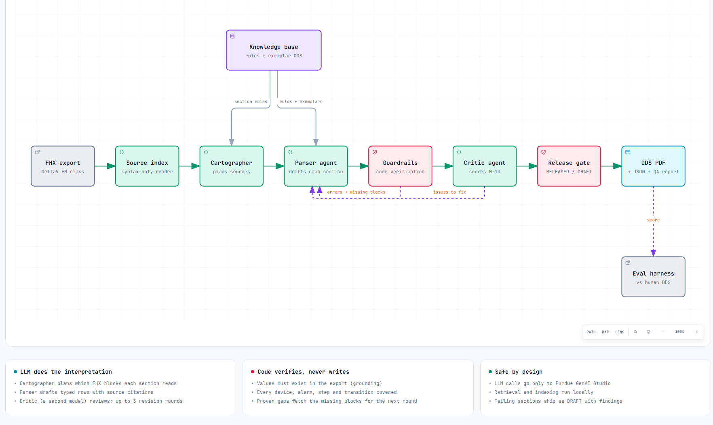

# DDS Agent

**An agentic LLM system that turns an Emerson DeltaV FHX export into a reviewed Detailed Design
Specification (DDS) PDF.**

Engineers today read raw DeltaV exports (UTF-16 text, thousands of nested blocks) or the
system printout to understand an equipment module. DDS Agent produces the human-readable
specification instead: one PDF per equipment-module class, in the layout of the hand-written
AstraZeneca DDS, with every table traceable to the export and a quality report attached.

Built for the Purdue Data Mine × AstraZeneca *Transforming DeltaV* project.

> [!IMPORTANT]
> **Confidential data.** FHX exports, DDS documents and everything derived from them are
> AstraZeneca-confidential. The code sends data only to Purdue GenAI Studio
> (`genai.rcac.purdue.edu`) and enforces this in code. Retrieval and indexing run locally.
> `input/`, `output/`, `data/`, `*.fhx` and `*.docx` are git-ignored; never commit them.

---

## Contents

- [At a glance](#at-a-glance)
- [Architecture](#architecture)
- [Quick start](#quick-start)
- [Usage](#usage)
- [How it works](#how-it-works)
- [What the PDF contains](#what-the-pdf-contains)
- [Configuration](#configuration)
- [Evaluation and results](#evaluation-and-results)
- [Project structure](#project-structure)
- [Development guide](#development-guide)
- [Troubleshooting](#troubleshooting)
- [Data handling](#data-handling)
- [Known limitations](#known-limitations)

---

## At a glance

| | |
|---|---|
| **Input** | One DeltaV `.fhx` export of an equipment-module (EM) class |
| **Output** | `<module>_DDS.pdf` (the deliverable), plus `<module>_dds.json` (structured data) and `<module>_qa.json` (quality report) |
| **Agents** | Cartographer (plans), Parser (extracts), Critic (reviews) |
| **Models** | `gpt-oss:120b` (cartographer + parser), `gemma4:26b-a4b` (critic), on Purdue GenAI Studio |
| **Quality controls** | Deterministic guardrails, independent critic, up to 3 revision rounds per section, release gate |
| **Accuracy** | Cell-level F1 **0.98** against a hand-written reference DDS; a second, unseen module released without code changes |
| **Runtime** | About 6 minutes and about 55 LLM calls per module |

---

## Architecture



Open [`docs/architecture.html`](docs/architecture.html) in a browser for the interactive version
(guided views, zoom, search, light/dark, export). The diagram source is
[`docs/architecture.json`](docs/architecture.json).

**In one sentence:** the LLM agents do all the interpretation, code only verifies their work, and
a release gate decides whether the document is fit to hand to an engineer.

| Stage | What it does | Code |
|---|---|---|
| Source index | Reads FHX *syntax* only (no DeltaV rules), cuts it into searchable chunks, builds an outline | [`fhx/`](src/dds_agent/fhx) |
| Knowledge base | Section rules, PCSD conventions and example DDS documents used for retrieval (RAG) | [`knowledge/`](src/dds_agent/knowledge) |
| Cartographer agent | Reads the outline and plans which FHX blocks each DDS section needs; checks its own plan and repairs it | [`agents/cartographer.py`](src/dds_agent/agents/cartographer.py) |
| Parser agent | Writes one section (or one command sequence) as typed rows, citing the FHX source of every row | [`agents/parser.py`](src/dds_agent/agents/parser.py) |
| Guardrails | Code checks: values exist in the export, nothing is dropped, slots and counts are consistent; fetches missing source | [`guardrails/checks.py`](src/dds_agent/guardrails/checks.py) |
| Critic agent | A second model scores the section 0–10 and lists concrete fixes | [`agents/critic.py`](src/dds_agent/agents/critic.py) |
| Orchestrator + release gate | Runs the per-section loop in parallel and decides RELEASED or DRAFT | [`orchestrator.py`](src/dds_agent/orchestrator.py) |
| Renderer | Produces the PDF in the DDS layout, with a QA appendix | [`render/pdf.py`](src/dds_agent/render/pdf.py) |
| Evaluation harness | Scores a generated DDS against a hand-written one, cell by cell (offline) | [`evaluation/`](src/dds_agent/evaluation) |

---

## Quick start

**Prerequisites:** Python 3.11+ and a Purdue GenAI Studio API key
(https://genai.rcac.purdue.edu → Settings → Account → API Keys).

```bash
git clone <repo-url> && cd Delta-V-parsing-Agent
python -m venv .venv && source .venv/bin/activate      # Windows: .venv\Scripts\activate
pip install -e ".[dev]"

cp .env.example .env                                   # then set GENAI_API_KEY=...
dds-agent models                                       # both models should show "available"

# Put an export in input/ and run it
dds-agent run input/_EM-EXAMPLE-CL.fhx
```

The run prints the release status and the paths of the PDF, JSON and QA report:

```text
RELEASED: output/EM-EXAMPLE-CL/EM-EXAMPLE-CL_DDS.pdf
  reason: all guardrails passed; mean critic score 9.9
```

Without installing, every command also works as `PYTHONPATH=src python -m dds_agent ...`.

**Optional but recommended:** put approved, hand-written DDS `.docx` files in
`data/exemplars/`. The agents use them as style examples for *other* modules (see
[Retrieval](#retrieval-rag)).

---

## Usage

| Command | Purpose |
|---|---|
| `dds-agent run <file.fhx \| folder>` | Generate the DDS for one export, or for every `.fhx` in a folder |
| `dds-agent run <file.fhx> --truth <spec.docx>` | Generate and score against a hand-written DDS |
| `dds-agent eval <x_dds.json> --truth <spec.docx>` | Score an existing run without calling the LLM |
| `dds-agent render <x_dds.json>` | Re-render the PDF from saved JSON (no LLM calls) |
| `dds-agent outline <file.fhx>` | Print the structural outline the cartographer sees (debugging) |
| `dds-agent models` | Check the configured models are served by GenAI Studio |

Useful `run` options:

| Option | Default | Meaning |
|---|---|---|
| `--out DIR` | `output/<module>/` | Output folder |
| `--sections ID [ID ...]` | all | Generate only some sections (fast iteration), e.g. `--sections alarms hold_monitors` |
| `--max-iterations N` | 3 | Parse → verify → review rounds per section |
| `--generator-model`, `--critic-model` | from config | Try other GenAI Studio models |
| `--workers N` | 3 | Sections processed in parallel |
| `-v` | off | Debug logging |

`run` exits with code **1** when the document is not released, so it can gate a CI job.

### Output files

| File | Audience | Content |
|---|---|---|
| `<module>_DDS.pdf` | Engineers, reviewers | The specification: cover with release status, table of contents, all DDS sections, Appendix A with QA scores and open findings |
| `<module>_dds.json` | Developers, downstream tools | The same content as typed data, with source citations per row |
| `<module>_qa.json` | Developers | Per-section scores, iterations, guardrail findings, the cartographer's plan, LLM usage (calls, tokens, time) |
| `<module>_eval.md` / `.json` | Developers | Only with `--truth`: per-section precision/recall/F1 and every difference |
| `output/dds_agent.log` | Developers | Run log (agent names, token counts, timings; never FHX content) |

---

## How it works

### 1. Source index: syntax only

[`fhx/tree.py`](src/dds_agent/fhx/tree.py) decodes UTF-16 and parses the generic FHX block syntax
(`KEYWORD ATTR=value { ... }`, quoted strings with `""` escapes, split literals, `/* */`
comments). [`fhx/source.py`](src/dds_agent/fhx/source.py) then:

- renders blocks compactly without layout noise (graphics, rectangles, IDs);
- splits the file into chunks for lexical search, attaching path-scoped overrides
  (`ACT2/T_EXPRESSION`) to their block;
- follows references between blocks (`DEFINITION=`, `MODULE=`), so a selector can reach a
  composite's internals through DeltaV-style paths such as `MONITOR/HM01/DESC`;
- builds the outline the cartographer reads, and identifies the main EM class as the
  module class that no other block references.

It assigns **no** DeltaV meaning to any keyword. That is why a reorganized or unfamiliar
export still parses; interpreting it is the agents' job.

### 2. Retrieval (RAG)

[`knowledge/store.py`](src/dds_agent/knowledge/store.py) serves two kinds of context per section:

- **Rules:** curated markdown in [`knowledge/kb/`](src/dds_agent/knowledge/kb), covering an FHX
  primer, how each DDS section is derived (including which FHX blocks it needs), and PCSD
  library conventions (standard parameters, alarm functions, monitor slots).
- **Exemplars:** sections of hand-written DDS documents from `data/exemplars/*.docx`, read by
  [`knowledge/dds_docx.py`](src/dds_agent/knowledge/dds_docx.py).

**Leave-one-out:** when module X is generated or evaluated, exemplars of X itself are
excluded, so the agents never see the answer.

Retrieval is local TF-IDF tuned for identifiers ([`rag/retriever.py`](src/dds_agent/rag/retriever.py)).
FHX content is dominated by exact names (`EM_MIX_SPD_SP`, `COMMAND_00002`) that lexical search
matches better than embeddings. No embedding service is needed, and no text leaves the machine for indexing.

### 3. The agents

**Cartographer** reads the outline plus the section rules and returns a plan: for each DDS
section, a list of structural *selectors*. For example:

```json
{"scope": "_EM-EXAMPLE-CL", "keyword": "ATTRIBUTE_INSTANCE", "text_regex": "HISTORY_DATA_POINT"}
{"scope": "*", "keyword": "ACTION", "deep": true, "text_regex": "SM_\\d\\d\\.CV' := TRUE"}
```

The orchestrator executes every selector and reports back match counts, sizes and "similar
blocks" hints for selectors that matched nothing. The cartographer then repairs its own plan
(up to 2 rounds). Commands are planned as one sub-task per `COMMAND_0000n` block.

**Parser** receives one section's source, its rules and an exemplar, and returns typed JSON
validated against the schema in [`schema/dds.py`](src/dds_agent/schema/dds.py). It may answer
`need_more_context` once to trigger a search, repairs schema errors, and on later rounds revises
its previous draft from the feedback. Oversized source is split into batches and merged.

**Critic** runs on a different model family for an independent view. It scores
completeness, faithfulness and conformance (the score is the minimum of the three), hunts for
omissions first, and reports only actionable issues.

### 4. Guardrails: code verifies, never writes

[`guardrails/checks.py`](src/dds_agent/guardrails/checks.py) runs after every draft:

| Check | Catches |
|---|---|
| Schema | Rows that do not validate |
| Grounding | Names, classes, priorities and item IDs that do not occur in the export (invented values) |
| Coverage | Missing module blocks, alarms, history points, SFC actions or transitions (dropped items) |
| Shape | Wrong row counts (16 monitor slots), duplicate keys, missing required properties |
| Template leakage | Placeholder text such as `<SET>` copied into the output |
| Slot consistency | `OPnnn`/`TPnnn`/`RPnnn` number, min and max must match the export; defaults must equal instance values |
| Sentinel enablement | A slot is used if and only if some command writes `SM_nn := TRUE`, and a used slot must name a device |
| FBD accounting | Every block with its own expression is either documented or excluded with a stated reason; absence claims are rejected |
| Cross-section | Sentinel devices must be documented devices; parameter numbers unique |

**Guardrails also drive retrieval.** When a check proves that something exists in the export
but was not in the agent's source, it attaches selectors for exactly those blocks, and the
orchestrator adds them before the next round. A weak plan therefore cannot cap quality.

### 5. Loop and release gate

For every section, and every command, in parallel:

```text
for round in 1..3:
    draft  = parser(source, rules, exemplar, feedback)
    checks = guardrails(draft)            # errors cap the score at 6
    review = critic(draft, source, checks)
    if no errors and score >= 8.5: stop
    feedback = checks.errors + review.issues
    source  += blocks the guardrails proved missing
keep the best draft
```

The document is **RELEASED FOR ENGINEERING REVIEW** only if no section has guardrail errors,
the mean critic score is at least 8.0 and no section is below 6.0. Otherwise it is issued as
**DRAFT** with every open finding listed in Appendix A. A crash in one section is isolated: the
section is recorded as failed and the document is still produced as DRAFT.

---

## What the PDF contains

The section order and wording follow the hand-written AstraZeneca DDS:

| # | Section | Built from |
|---|---|---|
| 1.1 | Overview | Class description, devices, commands |
| 1.2 | Properties | Named set, description, scan rate, displays |
| 1.3 | Control Module Interface | Module blocks: class, role, ownership |
| 1.4 | Parameter Interface | `EM_*` and standard interface parameters with OP/TP/RP slots, type, min, max, default |
| 1.5 | Alarms | Alarm parameters: priority, enabled, inverted, type, function |
| 1.6 | Historical Data Collection | History points |
| 1.7 | Failure Conditions | Hold monitors HM01–16, sentinel monitors SM01–16 |
| 1.8 | Command Sequences | Command properties, then one sequence table per command (step, item, delay, description) |
| 1.9 | Function Block Diagram Custom Logic | Custom ACT/CND/CALC blocks explained in plain English |
| 1.10–1.11 | Linked and Embedded Composites | Project composites (framework composites excluded) |
| 1.12 | Operator Interfaces | Faceplate, detail faceplate, dynamo |
| App. A | Quality Assurance Report | Scores, iterations, guardrail findings, questions for the reviewing engineer |

---

## Configuration

Settings come from environment variables or `.env` (see [`.env.example`](.env.example) and
[`config.py`](src/dds_agent/config.py)).

| Variable | Default | Purpose |
|---|---|---|
| `GENAI_API_KEY` | — (required) | Purdue GenAI Studio key |
| `DDS_BASE_URL` | `https://genai.rcac.purdue.edu/api` | Endpoint; any other host is refused |
| `DDS_GENERATOR_MODEL` | `gpt-oss:120b` | Cartographer and parser |
| `DDS_CRITIC_MODEL` | `gemma4:26b-a4b` | Critic (use a different model family) |
| `DDS_MAX_ITERATIONS` | `3` | Revision rounds per section |
| `DDS_PASS_SCORE` | `8.5` | Score at which a section stops revising |
| `DDS_RELEASE_MIN_MEAN` | `8.0` | Mean section score needed for release |
| `DDS_RELEASE_MIN_SECTION` | `6.0` | Lowest section score allowed for release |
| `DDS_MAX_PROMPT_TOKENS` | `40000` | Prompt budget (models have a 65,536-token context) |
| `DDS_MAX_OUTPUT_TOKENS` | `16000` | Completion cap per call |
| `DDS_REQUEST_TIMEOUT_S` | `600` | Per-request timeout |
| `DDS_TEMPERATURE` | `0` | Sampling temperature |
| `DDS_EXEMPLAR_DIR` | `data/exemplars` | Hand-written DDS `.docx` files used for retrieval |
| `DDS_OUTPUT_DIR` | `output` | Where runs are written |

---

## Evaluation and results

`--truth` (or `dds-agent eval`) compares the generated DDS with a hand-written one. Rows are
matched by key. Identifier columns must match exactly; prose columns (descriptions, alarm
function, delay wording) match at token-overlap F1 ≥ 0.6. The report gives row
precision/recall and cell precision/recall/F1 per section, plus every difference
([`evaluation/metrics.py`](src/dds_agent/evaluation/metrics.py)).

**Reference module vs its hand-written DDS** (its own exemplar excluded):

| Section | Rows (truth / generated) | Cell F1 |
|---|---|---:|
| Properties | 6 / 6 | 1.00 |
| Control Module Interface | 13 / 13 | 0.96 |
| Parameter Interface | 22 / 22 | 0.97 |
| Alarms | 5 / 5 | 1.00 |
| Historical Data Collection | 2 / 2 | 1.00 |
| Hold Monitors | 16 / 16 | 1.00 |
| Sentinel Monitors | 16 / 16 | 1.00 |
| FBD Custom Logic | 9 / 14 | 0.72 |
| Command sequences (7 commands) | 179 / 179 | 0.98–1.00 |
| **Overall (micro)** | row recall 1.00 | **0.979** (P 0.972 / R 0.986) |

**Reading the remaining differences.** Most are places where the hand-written spec is older than
the export and the generated document follows the export:

- five FBD blocks exist in the FHX but not in the spec;
- one SFC action has an expression in the FHX where the spec says N/A;
- one action description is the FHX text where the spec paraphrases.

Genuine misses need knowledge the export does not contain, e.g. expanding a bare instrument
abbreviation into the full description an engineer would write.

**Variance.** LLM planning is not deterministic: two consecutive full runs scored 0.979
(RELEASED) and 0.963 (DRAFT, correctly withheld by the gate). The guardrail-driven retrieval
added since targets exactly the failure that caused the DRAFT. Always check the release status,
not only the score.

**Generalization.** A second module, which the system was not tuned on, was released in every
run, and its content (commands, devices, monitors, alarms) matches the earlier prototype output.
There is no hand-written spec for it yet, so it has no cell score.

---

## Project structure

```text
Delta-V-parsing-Agent/
├── src/dds_agent/
│   ├── cli.py                 # dds-agent command line
│   ├── config.py              # settings + on-prem guard
│   ├── orchestrator.py        # plan → per-section loop → release gate → artifacts
│   ├── logging_setup.py
│   ├── fhx/
│   │   ├── tree.py            # decode, tokenize, generic block tree
│   │   └── source.py          # rendering, chunks, selectors, outline, references
│   ├── rag/retriever.py       # local TF-IDF for identifiers
│   ├── knowledge/
│   │   ├── kb/*.md            # curated rules (FHX primer, DDS section rules, PCSD conventions)
│   │   ├── store.py           # rules + exemplars, leave-one-out retrieval
│   │   └── dds_docx.py        # reads hand-written DDS .docx (exemplars and ground truth)
│   ├── llm/client.py          # GenAI Studio client: JSON mode, budgets, backoff, usage ledger
│   ├── agents/
│   │   ├── cartographer.py    # plans and self-repairs source selection
│   │   ├── parser.py          # section extraction, retrieval requests, revisions
│   │   ├── critic.py          # independent scoring
│   │   └── prompts.py         # all prompt templates
│   ├── guardrails/checks.py   # deterministic verification + missing-source fetch
│   ├── schema/dds.py          # typed DDS model and section registry
│   ├── evaluation/            # metrics.py, harness.py
│   └── render/pdf.py          # fpdf2 renderer (pure Python, no native libraries)
├── tests/                     # offline tests: syntax layer, guardrails, metrics, agent loop
│   └── fixtures/mini_em.fhx.txt   # synthetic FHX (no confidential data)
├── docs/                      # architecture diagram (PNG, interactive HTML, JSON source)
├── data/exemplars/            # hand-written DDS .docx files (git-ignored)
├── input/                     # FHX exports to process (git-ignored)
├── output/                    # generated runs (git-ignored)
├── pyproject.toml, requirements.txt, .env.example
```

---

## Development guide

### Tests and lint

```bash
pytest                    # 32 offline tests, about 2 s, no API key needed
ruff check src tests      # optional lint
```

The agent-loop tests ([`tests/test_orchestrator.py`](tests/test_orchestrator.py)) use a scripted
fake LLM, so the loop, guardrail feedback, release gate and PDF rendering are tested without
network access. Live runs need `GENAI_API_KEY`.

### Iterating on one section

```bash
dds-agent run input/_EM-EXAMPLE-CL.fhx --sections parameter_interface --out /tmp/try
dds-agent eval output/EM-EXAMPLE-CL/EM-EXAMPLE-CL_dds.json --truth "<spec.docx>"
```

`<module>_qa.json` shows the cartographer's plan and every guardrail finding: start there when a
section is wrong.

### Common changes

| Goal | Where |
|---|---|
| Improve how a section is derived | Edit its rule in [`knowledge/kb/10_dds_sections.md`](src/dds_agent/knowledge/kb/10_dds_sections.md). Rules are tagged `## [section:<id>]` and served only to that section |
| Add a plant or library convention | [`knowledge/kb/20_pcsd_conventions.md`](src/dds_agent/knowledge/kb/20_pcsd_conventions.md) |
| Better wording on new modules | Add approved DDS `.docx` files to `data/exemplars/` (no code change) |
| Catch a new class of error | Add a check in [`guardrails/checks.py`](src/dds_agent/guardrails/checks.py); return `fetch` selectors when the fix needs more source; add a test |
| Add a section or column | `SECTIONS` in [`schema/dds.py`](src/dds_agent/schema/dds.py) → rule in the KB → layout in [`render/pdf.py`](src/dds_agent/render/pdf.py) → reader in [`dds_docx.py`](src/dds_agent/knowledge/dds_docx.py) if you evaluate it |
| Change prompts | [`agents/prompts.py`](src/dds_agent/agents/prompts.py) (re-run an evaluation afterwards) |
| Update the architecture diagram | Edit [`docs/architecture.json`](docs/architecture.json) and re-render it with [Archify](https://github.com/tt-a1i/archify) |

Design rule: **guardrails verify, they never generate content.** If you find yourself writing
code that produces DDS values, put the knowledge in the KB instead and let a guardrail check
the result.

---

## Troubleshooting

| Symptom | Cause and fix |
|---|---|
| `GENAI_API_KEY is not set` | Copy `.env.example` to `.env` and add the key |
| `Refusing to send NDA data to non-Purdue host` | `DDS_BASE_URL` points elsewhere; this is intentional |
| `rate limited ... retrying` in the log | GenAI Studio throttling (reported as HTTP 400); the client backs off automatically. Lower `--workers` if it persists |
| `prompt ... exceeds budget` | A section's source is too large; check the plan in `_qa.json`, or narrow it with KB rules |
| PDF says **DRAFT** | Read Appendix A or `_qa.json`: it lists the guardrail errors and critic issues that blocked release |
| A section is wrong but passed | Add or tighten a guardrail for that failure, or clarify the KB rule; run with `--truth` to measure |
| Odd glyphs in the PDF | No Unicode font found (Arial/DejaVu); install one, or non-Latin-1 characters are replaced |
| `dds-agent models` shows NOT AVAILABLE | Model renamed on GenAI Studio; set `DDS_GENERATOR_MODEL` / `DDS_CRITIC_MODEL` |

---

## Data handling

- [`config.assert_on_prem()`](src/dds_agent/config.py) refuses any endpoint other than
  `genai.rcac.purdue.edu`; every LLM call goes through it.
- Indexing, retrieval, guardrails, evaluation and rendering run locally.
- Logs contain agent names, token counts and timings, never FHX content.
- `.gitignore` excludes secrets (`.env`), exports, DDS documents and all outputs.
- Generated documents are drafts for engineering review. A DeltaV engineer must review and
  approve them before use in a controlled (GMP) specification.

---

## Known limitations

- **Engineering knowledge absent from the export** (e.g. a device's process role when its
  description is only a library class name) cannot be recovered. The PDF shows what the
  export says.
- **Run-to-run variance** comes from LLM planning; the release gate, not the score, is the
  safeguard.
- **Scope:** built and measured on command-driven PCSD equipment-module classes. Other module
  types parse, but their sections may need new KB rules.
- **Sequence diagrams** from the hand-written DDS are not generated; sequence tables are.
- **Ground truth** exists for one module so far. Adding more hand-written DDS documents improves
  both evaluation and generation.
